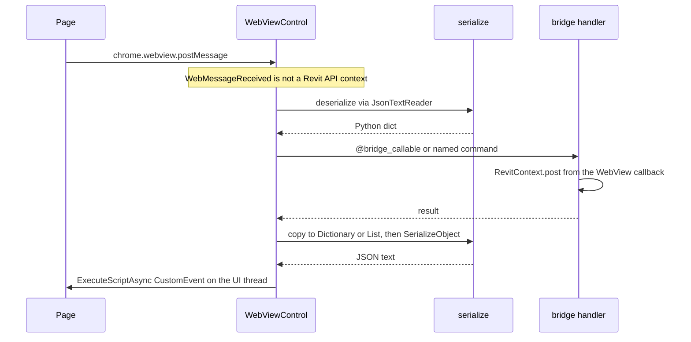

# Architecture

## Layers

```
┌─────────────────────────────────────────┐
│  Your window (WinForms / WPF)           │
│  WebView2 control (.NET)                │
└─────────────────┬───────────────────────┘
                  │ WebViewControl (Python)
                  ▼
┌─────────────────────────────────────────┐
│  pywebui (Python)               │
│  • WebViewSession / settings            │
│  • Bindable + @bridge_callable          │
│  • MessageRouter (postMessage)          │
│  • WpfUi / WinFormsUi (injected)        │
│  • host/wpf or host/winforms            │
│  • adapter/revit (optional host app)    │
└─────────────────┬───────────────────────┘
                  │ WebMessageReceived
                  ▼
┌─────────────────────────────────────────┐
│  Frontend (JavaScript / React)          │
│  chrome.webview.postMessage             │
│  window "bridge-response" CustomEvent   │
└─────────────────────────────────────────┘
```

## Request flow (JS → Python)

1. Page calls `chrome.webview.postMessage({ id, type: "invoke", method, params })`.
2. `WebMessageReceived` delivers JSON to `MessageRouter.handle_raw`.
3. Router dispatches to the `@bridge_callable` handler.
4. A WebView callback uses `RevitContext.post`. `invoke` waits only from another thread.
5. Router responds with `CustomEvent("bridge-response", { detail: { id, ok, data } })` via `ExecuteScriptAsync` on the UI thread.



A host that owns named commands uses `parse_request` and `response_message` on this same boundary. The event name in that script is the host's. `MessageRouter` emits `bridge-response`. The WebView callback uses `RevitContext.post`. `invoke` waits only from a thread that is not the Revit UI thread.

## Threading rules

| Operation | Thread |
|-----------|--------|
| `CoreWebView2.ExecuteScriptAsync` | WebView UI thread (`UiThread.post`) |
| `@bridge_callable` body | `WebMessageReceived` callback — marshal to UI/Revit inside handler when needed |
| Revit API | `RevitContext.invoke` or `post` after `initialize` |

## JSON

`pywebui.serialize` is Newtonsoft.Json. `MessageRouter` and `parse_request` both go through it.

`serialize` copies a Python dict or list into `Dictionary` / `List`, then calls `JsonConvert.SerializeObject`. An IronPython dict passed straight in is reflected as a CLR object, and that walk does not finish. Non-ASCII characters are escaped.

`deserialize` reads with `JsonTextReader` into Python dicts, lists, and scalars. It does not touch `JToken` members.

If Revit has already loaded `Newtonsoft.Json`, that assembly is the one imported. `bin/Newtonsoft.Json.dll` is the fallback for every other host.

## Shipped `bin/` (.NET fallbacks only)

| DLL | Role |
|-----|------|
| `Microsoft.Web.WebView2.*` | WebView2 managed API when the host has not loaded it |
| `Revit.Async.dll` | External event behind `RevitContext` |
| `Newtonsoft.Json.dll` | `serialize` / `deserialize` when the host has not loaded Newtonsoft |
| `WebView2Loader.dll` | Native WebView2 loader |

No custom bridge assembly. Python + IronPython/pythonnet orchestrates the .NET WebView2 control directly. The file list and `sync-bin.ps1` live in [install.md](install.md).

## Dispose

`WebViewControl.dispose()`:

- Unhooks `CoreWebView2InitializationCompleted`
- Disposes `WebView2` on UI thread
- Clears router reference

Always call when the host window closes.
